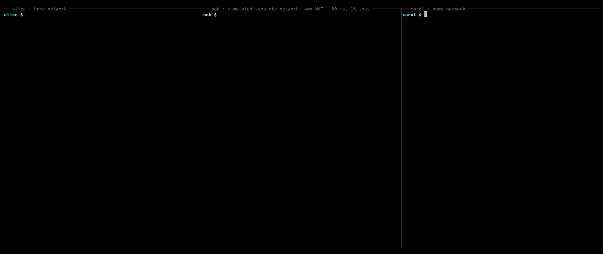

# PotluckTune

[](https://github.com/jtxmp/potlucktune/actions/workflows/test.yml)
[](https://www.npmjs.com/package/potlucktune)
[](LICENSE)
[](package.json)

PotluckTune is a CLI for fine-tuning one LoRA adapter on data held by several people, without moving the data and without a server. Each member trains on their own machine. Members exchange only adapters, over [Hyperswarm](https://github.com/holepunchto/hyperswarm), record each round in a shared [Autobase](https://github.com/holepunchto/autobase), and each computes the same merge locally. At the end every member holds a byte-identical adapter and can check that the others do too.

It uses the same identity and `team.json` format as [PotluckLLM](https://github.com/jtxmp/potluckllm) and [PotluckRAG](https://github.com/jtxmp/potluckrag).



*Alice, bob and carol each hold tickets for 4 of 12 intents. Bob is on a simulated separate network (own NAT, LAN blocked, 80 ms delay, 1% loss, via `scripts/simnet.sh`). After three rounds all three report the same merged adapter, and on the shared test set bob's copy scores 0.917, against 0.396 for the adapter he trained alone and 0.238 for the base model. Real training of Qwen2.5-0.5B-Instruct on one laptop GPU, which the three members take turns on. About 3 minutes, not sped up. Reproduce with `vhs demo/demo.tape`.*

## Who it is for

- A few people or organisations who each hold labelled examples they won't hand over (support tickets, internal documents, client data) and want one model that learned from all of them.
- Teams without a server that every member can reach, or where nobody should be the one who collects everyone's updates.

Members must trust each other with adapters. An adapter is not the data, but it is derived from it; see [Security](#security).

## Result on a demo task

Twelve banking intents, three members, each holding four of them ([eval/README.md](eval/README.md)):

| Training | Accuracy on all 12 intents (mean of 3 seeds) |
|---|---|
| Base model, no adapter | 0.238 |
| Each member alone | 0.381 |
| PotluckTune, 3 rounds | 0.907 |
| All data on one machine | 0.942 |

Each member alone cannot learn the intents it never saw. After three rounds of PotluckTune, each member's model is within 0.035 of training on the pooled data, and no member's data left their machine. The split is the extreme case (no shared labels); the eval README lists the limits.

## How it works

```
 alice                         bob                           carol
 ┌───────────────────┐         ┌───────────────────┐         ┌───────────────────┐
 │ alice.jsonl       │         │ bob.jsonl         │         │ carol.jsonl       │
 │   │ train B       │         │   │ train B       │         │   │ train B       │
 │   ▼ (frozen A)    │         │   ▼               │         │   ▼               │
 │ adapter ──────────┼──┐   ┌──┼── adapter         │   ┌─────┼── adapter         │
 │                   │  │   │  │                   │   │     │                   │
 │ Autobase: post r  │◀─┴───┴──┴─▶ Autobase ◀──────┴───┴────▶│ Autobase          │
 │ all posted?       │  Hyperswarm (team keys only)          │                   │
 │ fetch + check sha │         │                   │         │                   │
 │ merge (mean of B) │         │ merge             │         │ merge             │
 │ post merged sha   │         │ post merged sha   │         │ post merged sha   │
 └───────────────────┘         └───────────────────┘         └───────────────────┘
          same bytes, compared through the Autobase, then the next round
```

1. **Frozen A, trained B (FFA-LoRA).** Every member derives the same LoRA A matrices from the team seed and trains only B. Because A is shared, averaging the members' B matrices gives exactly the average of their weight updates (B·A). Plain averaging of standard LoRA does not, since the mean of B times the mean of A is not the mean of B·A.
2. **Rounds in an Autobase.** The owner's `init` creates the base with the member list, the training config and a hash of the frozen A. Members join with a request signed by their identity key; only listed keys become writers. Each round a member appends a post (adapter hash, size, example count) and stores the adapter in a Hyperblobs core.
3. **No coordinator.** A round is complete when every member has posted. Which posts count does not depend on the order they arrive in, so every member merges the same set. Each fetches the adapters, checks every hash, and computes the merge: the example-weighted mean of B, in a fixed order, summed in float64, cast once to float32. Members append the hash of their merge, and `train` reports whether all of them match.
4. **Next round** starts from the merged adapter.

Data never leaves the machine it is on. Adapters (about 0.8 MB each for the default config) and the shared log are the only things sent.

## Requirements

- Node 22 or later
- Python with PyTorch, transformers and peft (tested with Python 3.12) ([trainer/requirements.txt](trainer/requirements.txt)). A GPU helps but is optional: a round of the default config took 4 s on a 4 GB laptop GPU and about 2 minutes on CPU (two trainers sharing a 12-thread laptop CPU).
- The default base model is [Qwen/Qwen2.5-0.5B-Instruct](https://huggingface.co/Qwen/Qwen2.5-0.5B-Instruct) (Apache-2.0), downloaded from Hugging Face on first use.

## Quickstart

```sh
npm install -g potlucktune      # or: pnpm add -g potlucktune

# The trainer's Python environment, once per machine
python3 -m venv ~/.potlucktune-venv
~/.potlucktune-venv/bin/pip install torch==2.11.0 --index-url https://download.pytorch.org/whl/cu128   # or the CPU build
~/.potlucktune-venv/bin/pip install -r https://raw.githubusercontent.com/jtxmp/potlucktune/v0.1.0/trainer/requirements.txt
export POTLUCKTUNE_PYTHON=~/.potlucktune-venv/bin/python
```

1. Each member prints their public key and sends it to the owner:

   ```sh
   potlucktune id
   ```

2. The owner creates the team file and starts a run. The label list comes from any file that contains every label:

   ```sh
   potlucktune team init support-intents --member alice
   potlucktune team add bob <bob's key>
   potlucktune team add carol <carol's key>
   potlucktune init --labels-from labels.jsonl
   ```

   `init` writes the run's key into `team.json`. Send that file to every member over a private channel.

3. Every member trains on their own data:

   ```sh
   potlucktune train --data mine.jsonl --rounds 3
   ```

   Members can start at different times. Each round waits until everyone has posted. If a member stops, running the same command again continues from where it stopped.

4. Use the result:

   ```sh
   potlucktune eval --data test.jsonl --baseline
   potlucktune export --out ./adapter
   ```

   `export` writes a standard PEFT adapter: `PeftModel.from_pretrained(base_model, "./adapter")`.

### Data format

JSONL, one example per line. Labels must be in the run's label list.

```json
{"text": "I still haven't received my new card", "label": "card_arrival"}
```

### Try it without Python

```sh
npx potlucktune try
```

Three members on one machine, connected over the public DHT, run three rounds with a stand-in trainer (no model). The joins, posts, blob transfers, hash checks and merges are the real code. It takes about 15 seconds.

### Rehearse with the real trainer

From a clone, with the Python environment in `.venv`:

```sh
.venv/bin/python scripts/make_demo_data.py    # downloads Banking77, builds the 3-member split
scripts/rehearse.sh 3
```

Runs `team init`, `init`, three `train` processes (each with its own HOME) and `eval`.

## Commands

| Command | Description |
|---|---|
| `try` | Three members, a stand-in trainer, the real network path |
| `id` | Print your public key; create it on first run |
| `team init <team-name> [--member <name>]` | Create a team file with you as the first member |
| `team add <name> <public-key>` | Add a member to the team file |
| `init --labels-from <file>` | Owner: start a training run for the team file's members |
| `train --data <file>` | Train, publish, merge, round by round |
| `status` | Recent rounds, posts and merges from the last `train` |
| `eval --data <file>` | Accuracy of the latest merged adapter (and your own adapter of that round) |
| `export --out <dir>` | Write the merged adapter as a PEFT adapter directory |

## Options

| Option | Used by | Default |
|---|---|---|
| `--team <file>` | all but `try`, `id` | `./team.json` |
| `--data <file>` | `train`, `eval` | |
| `--rounds <n>` | `train` | `3` |
| `--round <n>` | `eval`, `export` | latest |
| `--labels-from <file>` | `init` | |
| `--config <file>` | `init`: JSON overriding the training config below | |
| `--python <path>` | `init`, `train`, `eval`, `export` | `$POTLUCKTUNE_PYTHON` or `python3` |
| `--device <d>` | same | `auto` (`cuda` if available) |
| `--linger <s>` | `train`: after the last round, wait for the others | `120` |
| `--baseline` | `eval`: also score the base model | off |
| `--bootstrap <list>` | network commands: DHT bootstrap nodes `host:port,...` | public DHT |

Training config (set by the owner at `init`, shared with every member through the run):

| Key | Default | Meaning |
|---|---|---|
| `model` | `Qwen/Qwen2.5-0.5B-Instruct` | Hugging Face model id. Local paths are refused. |
| `rank`, `alpha` | `8`, `16` | LoRA rank and scale |
| `targets` | `["q_proj", "v_proj"]` | Modules that get LoRA |
| `seed` | `1234` | Seeds the frozen A and batch order |
| `lr`, `steps`, `batch`, `maxLen` | `0.002`, `40`, `8`, `96` | Per round, per member |
| `labels` | from `--labels-from` | The classes; at least 2 |

## Security

The threat model is in [docs/threat-model.md](docs/threat-model.md). In short:

- Only keys in `team.json` can connect (Hyperswarm firewall), and only members can write to the run: a join request must be signed by a listed key.
- Every adapter is checked against the hash in its post before it is merged. Adapters with NaN or Inf values, other tensor names or other shapes stop the merge instead of entering it.
- The training config comes from the owner, and members validate it: the model must be a Hugging Face id, not a path, and numbers must be in range. Adapters are read with safetensors, never pickle.
- Not covered: a member can send an adapter trained to degrade or backdoor the model (the merge is a plain mean, not a robust one), and every member receives every other member's adapter, which can leak facts about their data. Secure aggregation and robust merging are open issues.

## Limitations

- A round waits for every member. A member who never posts stalls the run until the owner removes them from `team.json`.
- Change the member list between runs, not during one; a change mid-round can make members disagree about which posts count (they would see it, as different merge hashes).
- One run per team file. For a new run, create a new team file.
- Tested on Linux with one GPU and on CPU. The three-member rehearsals ran on one machine; separate networks were tested only through simulation in the sibling projects.
- Classification only. The trainer scores labels; generation tasks need a different loss and eval.

## Development

```sh
pnpm test        # Node tests; the merge test also runs eval/run.py's merge if .venv exists
.venv/bin/python eval/run.py --rounds 3 --seeds 1,2,3
```

[spike/RESULTS.md](spike/RESULTS.md) has the measurements behind the design. [CONTRIBUTING.md](CONTRIBUTING.md) covers setup and pull requests.

## Credits

Banking77 (Casanueva et al., 2020, PolyAI) is used under CC-BY-4.0 for the demo and eval; it is downloaded by `scripts/make_demo_data.py`, not included. FFA-LoRA: Sun et al., "Improving LoRA in Privacy-preserving Federated Learning", ICLR 2024.

## License

MIT
